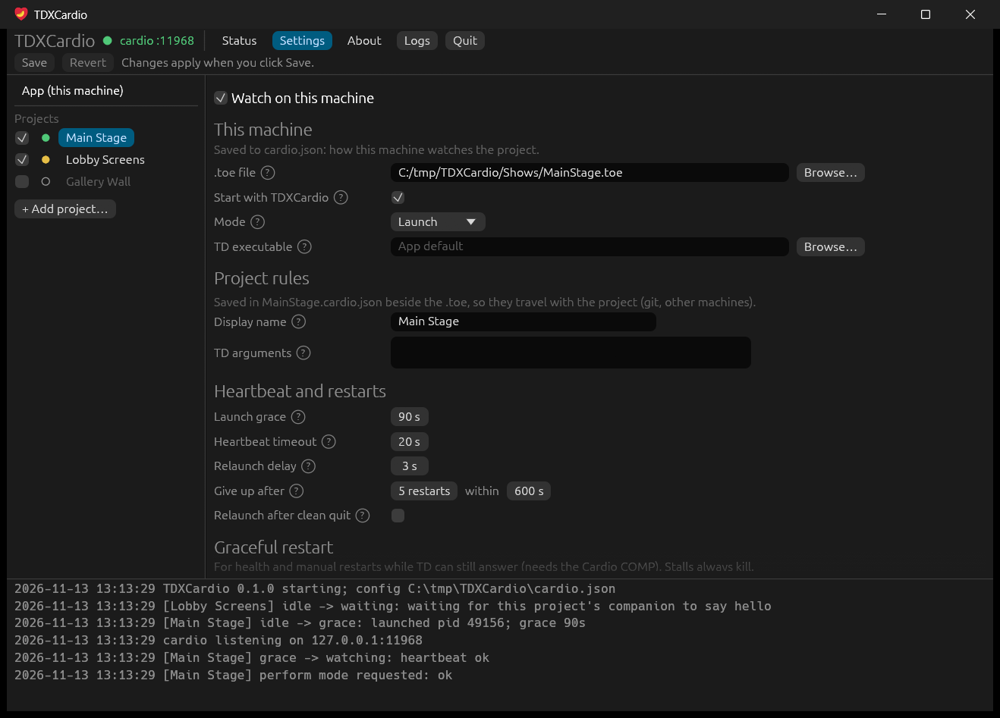

# TDXCardio

A heartbeat watchdog for TouchDesigner shows, for Windows and macOS. It keeps a
show running: it launches the `.toe` (or attaches to one that is already open),
watches its heartbeat, and restarts it when it crashes, freezes or runs
unhealthy. Each restart collects evidence: a screenshot, a log entry and an
optional email.



## Features

- **Fast crash recovery**: TDXCardio watches TouchDesigner's process, so a crash
  is caught in about a second instead of after a heartbeat timeout.
- **Freeze detection**: no heartbeat for the timeout means a stall; it takes a
  screenshot first, then kills and relaunches TD.
- **Health rules** (optional): low fps or slow frames for long enough can be
  logged or trigger a restart.
- **Hold**: TD can ask for a pause before a known long stall (loading media,
  rendering), so the watchdog does not fire.
- **Graceful restarts**: when TD can still answer, it is asked to quit (and
  optionally save) before anything is killed. Restarts back off, and a crash
  loop gives up and alerts you.
- **Window control** (optional): keep TD's window focused, open its perform
  window, keep it on top. All off by default.
- **Evidence and alerts**: screenshots, daily logs, email on restart or give-up.
- **Status for other tools**: `status.json`, rewritten every second.
- **Several projects at once**, each with its own rules.
- **Settings in a window**: a Settings page with a tooltip on every option. Saves
  apply immediately and never restart TouchDesigner.

## Quick start

1. Build the app (see [Building](#building)) and run `tdxcardio(.exe)`. It sits
   in the tray; closing the window hides it there.
2. Drop `release/Cardio.tox` into your TouchDesigner project and save. This is
   the component that sends heartbeats (see [The TD side](#the-td-side)).
3. In TDXCardio, open **Settings**, click **+ Add project…** and pick the
   `.toe`, or open the project in TD and tick it in the Projects list once it
   appears there.
4. Click **Save**. The Status page shows the project as `watching` once
   heartbeats arrive.

The tray's **Quit** stops watching and leaves TouchDesigner running.

## The TD side

`release/Cardio.tox` is the companion component. Put it anywhere in a project.

- **Cardio page:** Active, Port (11998), Heartbeat Interval, Watch ID Override,
  and Hold / Hold Seconds / Release.
- **Status page:** Connected, Watch Phase and Restarts. TDXCardio fills these in,
  so the project can see that it is being watched.

Each heartbeat carries fps, frame cook time, dropped frames and perform mode.
TDXCardio can send commands back over the same connection: `ping`, `save`,
`quit` (for graceful restarts) and `perform`.

Hold and release from Python:

```python
op('Cardio').Hold(300, 'loading 40 GB of media')
op('Cardio').Release()
```

## Settings

Click **Settings** in the window. **App** holds this machine's settings.

The **Projects** list shows every project TDXCardio has seen: those in
`cardio.json`, plus any that have ever talked to it. The list is kept in
`known_projects.json` in the data folder, so a project stays listed when its
TouchDesigner session is closed. Each row has a checkbox that sets whether this
machine watches the project; the switch at the top of the project page does the
same. Rules can be edited whether or not the project is watched. **Forget**
removes an unwatched project from the list. Every setting has a circled **?**
that shows its tooltip on hover, and so do the Status table headers, phases and
port lamps.

Each project page has two parts, and each part says which file it saves to:

| Scope | File | Holds |
|---|---|---|
| This machine | `cardio.json` | ports, default TD executable, data folder, status file, start hidden, reboot after give-ups, email (SMTP); and which projects this machine watches: `.toe` path, start with TDXCardio, launch or attach, TD executable override |
| The project | `<Name>.cardio.json` beside the `.toe` | display name, TD arguments, timeouts, restart limits, graceful restart, health, window (focus, perform, topmost), evidence |

A project's rules travel with it: commit `Show.cardio.json` next to `Show.toe`,
and every machine that watches the show uses the same rules.
Increment-and-Save copies (`Show.28.toe`) share `Show.cardio.json`. A missing
rules file means defaults.

**Save** writes only what changed and applies it immediately. Watchers pick up
their new rules, and removed projects stop being watched. A save never restarts
TouchDesigner. Port and data-folder changes are the only ones that need a
TDXCardio restart, and the save message says so.

Watchers also re-read their rules file within 2 s when it changes on disk, for
example after a `git pull`. A rules file that fails to parse keeps the previous
rules and logs the error. When a project starts with a broken rules file, it is
shown as `error` and not watched; the app never falls back to defaults.

### Where the files are

The machine config is `--config <path>` if given, else `cardio.json` beside the
executable, else `%APPDATA%/TDXCardio/cardio.json` (on macOS
`~/Library/Application Support/TDXCardio`). A default file is written if none
exists. A config that fails to parse is reported in the log and the window, and
it is never overwritten.

`cardio.json`:

```json
{
  "cardio_port": 11998,
  "compat_port": 11999,
  "data_dir": "",
  "status_file": "",
  "td_executable": "",
  "reboot_after_gave_up": 0,
  "start_hidden": false,
  "email": { "enabled": false, "smtp_host": "smtp.gmail.com", "smtp_port": 587, "security": "starttls",
             "username": "", "password_env": "TDXCARDIO_SMTP_PASSWORD", "from": "", "to": [], "attach": true },
  "projects": [
    { "path": "D:/Shows/Main.toe", "enabled": true, "mode": "launch", "td_executable": "" }
  ]
}
```

`D:/Shows/Main.cardio.json`:

```json
{
  "name": "Main show",
  "args": [],
  "launch_grace_secs": 60,
  "timeout_secs": 30,
  "relaunch_delay_secs": 3,
  "max_restarts": 5,
  "restart_window_secs": 600,
  "relaunch_on_clean_exit": false,
  "graceful": { "enabled": true, "save": false, "timeout_secs": 10 },
  "health":   { "enabled": false, "min_fps": 20, "max_cook_ms": 0, "bad_secs": 30, "action": "log" },
  "window":   { "keep_focus": false, "focus_interval_secs": 5, "perform_mode": false, "topmost": false },
  "evidence": { "screenshot": true, "email_on_restart": false, "email_on_gave_up": true }
}
```

- **`mode`**: `launch` starts TD, or adopts a running session of the same project
  when its companion is already talking. `attach` never starts TD itself; it
  relaunches only after the session dies or stalls.
- **`td_executable`**: empty means the newest install under
  `C:/Program Files/Derivative` or `/Applications/TouchDesigner*.app`.
- **Relaunch delay**: it doubles per restart inside the window, capped at 60 s.
  Reaching `max_restarts` within `restart_window_secs` sets the phase to
  `gave_up`, sends the email, and counts toward `reboot_after_gave_up`.
- **Data folders**: `data_dir` (default: beside the config) holds `logs/`
  (one file per day), `captures/`, `known_projects.json` and `status.json`. Set
  `status_file` to `"off"` to disable the status file.
- **Older files**: rule keys still inside a `cardio.json` project row are
  ignored, and the log names the rules file they belong in.

### Command line

`tdxcardio(.exe) [--config cardio.json] [--headless | --settings]`

`--headless` runs without a window or tray. `--settings` opens the window on the
Settings page.

## Working alongside TDX Launcher Ultra

**TDX Launcher Ultra (TDXLU)** is Function Store's launcher for TouchDesigner
projects. It has a heartbeat watcher of its own, fed by its TD companion
component, **TDXLauncherUtility**. TDXCardio is a standalone app, but it speaks
the same heartbeat protocol, so the two can be used together:

- A project that only has TDXLauncherUtility (with Heartbeat Active) is still
  watched by TDXCardio, through TDXLU's port 11999. TDXCardio takes that port
  only while TDX Launcher Ultra is not running, so the two apps never fight over
  it. Such a project gets liveness, fps, `ping` and `save`, but not graceful
  quit, hold or perform, which need the Cardio component.
- A project with the Cardio component talks to TDXCardio on its own port
  (11998), whether or not TDX Launcher Ultra is running.

Compared with TDXLU's watcher, TDXCardio adds:

| | TDXLU watcher | TDXCardio |
|---|---|---|
| Crash detection | heartbeat timeout | **checks the process ID**: relaunch in about 1 s, not 60 s |
| Hung TD | timeout, then kill | screenshot first, then kill |
| Low fps or slow frames | no | optional health rule: log or restart |
| Known long stalls (load, render) | trip the watchdog | TD sends `hold`, and TDXCardio waits |
| Restart | kill + relaunch | **graceful** quit (optional save) when TD can still answer; exponential backoff; gives up on a crash loop |
| Back channel into TD | separate command port per session | same connection: `ping`, `save`, `quit`, `perform`, plus the watch state shown in TD |
| Focus / fullscreen | no | **optional**: keep focus (OS level), perform window, always on top |
| Multiple projects | yes | yes; attaches to sessions that are already running |
| Status for other tools | in its window | `status.json` rewritten every second |

The wire protocol is documented in [docs/PROTOCOL.md](docs/PROTOCOL.md).

## Ports

| Port | Owner | Notes |
|---|---|---|
| 11997 | TDX Launcher Ultra's control server | not used by TDXCardio |
| **11998** | TDXCardio | the Cardio component connects here |
| 11999 | TDX Launcher Ultra's heartbeat bus | TDXCardio's compatibility port: bound only when nothing else serves it, retried every 10 s |
| 12000-12099 | TDXLauncherUtility command ports | used only to send commands to TDXLauncherUtility-only projects |

Before binding a port, TDXCardio checks whether something already answers there.
Windows lets `127.0.0.1:N` bind beside another app's `0.0.0.0:N`, which would
otherwise split the traffic silently.

## Development

| Piece | Where | What |
|---|---|---|
| `app/` | Rust crate `tdxcardio` | the watchdog: egui window and tray, or `--headless` |
| `/Cardio` COMP | `TDXCardio.toe`, externalized as `Cardio.tdxn` + `Cardio/CardioExt.py`; `release/Cardio.tox` to drop into any project | the TD companion that sends heartbeats and answers commands |
| `docs/PROTOCOL.md` | | the wire protocol (cardio v1, a superset of TDX Launcher Ultra's heartbeat bus) |
| `app/tools/fake_td.py` | | a fake TD session for testing without TouchDesigner |

### Building

```bash
cd app && cargo build --release
```

The executable is `app/target/release/tdxcardio(.exe)`.

The icon (a heart with a banana) is drawn in code, in `app/src/icon.rs`. On
Windows, `app/build.rs` turns it into a multi-size `.ico` and embeds it in the
`.exe`; this needs `rc.exe` from the Windows SDK, which comes with the Visual
Studio C++ build tools that Rust uses anyway.

### Single sources of truth

| Data | Lives in | Reaches TD as | Reaches the app as |
|---|---|---|---|
| Watch rules (timeouts, health, window, evidence) | `<Name>.cardio.json` beside the `.toe` | `watch` messages (phase, restarts) → Status page parameters | re-read within 2 s of any change |
| Which projects this machine watches, ports, email | `cardio.json` | | loaded at start; Settings saves apply live |
| Port, interval, hold length | `/Cardio` custom parameters (`.tdxn`) | n/a | `hello` / `heartbeat` / `hold` |
| Project identity | the `.toe` path (`ProjectWatchId`, shared with TDXLauncherUtility) | | `id` on every message |
| Watch state for other tools | the app's memory | | `status.json` |
| Wire format | `docs/PROTOCOL.md` | `CardioExt.py` | `protocol.rs`, `bus.rs` |

### Testing

`app/tools/fake_td.py` acts as a TD session, in either the Cardio or the
TDXLauncherUtility dialect. Its `<file>.mode` sidecar switches it between `ok`,
`lowfps`, `hang`, `exit`, `hold` and `tdxlu`. The scenario covers every phase
transition, plus live reload of a project's rules file and a broken rules file
keeping the previous rules. It ran green on 2026-11-13 (17/17), and against a
live TouchDesigner session (watching, hold, reconnect after an extension
reinit).

## About and support

TDXCardio is made by Function Store. The window's **About** page has these
links, plus the locations of the settings and log files to attach to a
support request.

- Source code and issues: https://github.com/function-store/TDXCardio
- Function Store: https://functionstore.xyz/link-in-bio
- Support on Patreon: https://patreon.com/function_store

## Acknowledgements

TDXCardio was inspired by [Stalker](https://github.com/interactiveimmersivehq/Stalker/)
by The Interactive & Immersive HQ, a TouchDesigner watchdog.

## License

MIT, see [LICENSE](LICENSE).
